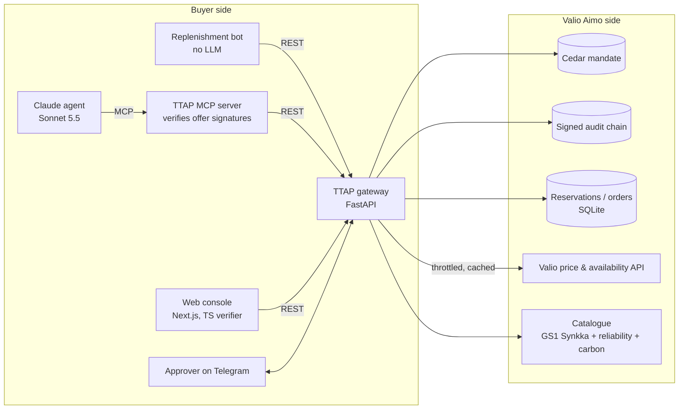

# TTAP — Trusted Trade Agent Protocol

**Junction 2026 · Valio Aimo challenge.** An open, verifiable interface through which external purchasing agents
buy from a food-service wholesaler: *request → lookup → order → approval*, with signed offers, a mandate enforced by
policy, human sign-off on Telegram or the web, and an audit trail both parties can verify.

> Not a chatbot over a webshop: the wholesaler publishes the protocol, any agent (LLM or plain script) can speak it,
> and nothing an agent says can change a price, a quantity or an approval.

## What it does
| Challenge requirement | TTAP |
|---|---|
| Product, price & availability lookup | Catalogue search with hard constraints (GS1 claims, labels, allergens), live price & stock from Valio, good/better/best tiers |
| Fixed-price inquiry → order | Signed, single-use offers (ES256 + RFC 8785) → order at the locked price, idempotent |
| Permissions & human approval | Cedar mandate → auto-approved / human / denied with reasons; Telegram & web approval; kill switch; what-if replay |
| Trust protocol | Assurance level on every claim (verified vs unknown stock, origin conflicts, missing data); buyer-side signature verification in Python **and** TypeScript |
| Partial availability & substitution | Split plan: available stock + official substitute + backorder, Peppol `CA` order response |
| Delivery & sustainability | Delivery reliability, cut-offs, labels and category carbon in ranking |
| Audit trail | CloudEvents, hash-chained, signed, verifiable offline; human-readable explanations from templates |

## Architecture

Hexagonal core (`ttap/domain` pure, `ttap/ports.py`, `ttap/adapters`). Decisions: [`docs/adr/`](docs/adr). Spec: [`SPEC.md`](SPEC.md). Assumptions: [`ASSUMPTIONS.md`](ASSUMPTIONS.md).

## Quickstart
```bash
cp .env.example .env            # set VALIO_API_KEY (and optionally ANTHROPIC_API_KEY, TELEGRAM_BOT_TOKEN)
# datasets from the challenge portal into resources/ (not committed)
uv sync
uv run --env-file .env uvicorn ttap.main:app --port 8811          # gateway
(cd web && npm install && npx next dev --port 3100)                 # console → http://localhost:3100
```
or `docker compose up --build`.

| Try | Command |
|---|---|
| Claude agent over MCP | `uv run --env-file .env python -m buyer_agent.reference_agent "1000 L of lactose-free milk for Monday"` |
| Plug Claude Desktop / Code | MCP stdio server: `python -m buyer_agent.mcp_server` with `TTAP_URL`, `TTAP_AGENT_KEY` |
| Replenishment bot (no LLM) | `uv run python -m buyer_agent.replenishment_bot --key demo-key-resto-b --once` |
| Precision eval | `uv run python eval/run_eval.py` → `eval/report.md` |
| Conformance kit | `uv run pytest conformance --server-url http://localhost:8811` → `conformance/compatibility.json` |
| Verify the audit log offline | `uv run python scripts/verify_audit.py audit.jsonl jwk.json` |
| Unit tests | `uv run pytest` |

## Results (live mock API, 2026-11-15)
- **Evaluation** (16 property-based cases, no LLM, `/orders/preview`): first-time-right 81 % → **100 %** after the full-word relevance fix; decision accuracy **100 %**; touchless rate **100 %** of expected auto-approvals; pass^3 consistency **100 %**; hard-constraint violations **0**. Small, team-written set — a regression guard, not a market claim.
- **Conformance kit:** 10/10 MUST, 2/2 SHOULD.
- **Interpreter** (Claude Haiku 5.5): FR/FI/EN free text → constraints in ~3 s, asks before guessing.
- **What-if:** raising the per-order limit to €5,000 → "3 of 10 past orders would have changed decision".
- **Tests:** 110 unit/integration tests.

## Repository
```
ttap/            gateway: domain (pure), application (use cases), adapters (REST, Telegram, Valio, Cedar, SQLite, JWS, Claude)
buyer_agent/     buyer side: verifying client, MCP server, Claude reference agent, replenishment bot
web/             Next.js console (New request · Orders · Approvals · Mandate · Audit log)
policies/        Cedar mandate policies
conformance/     protocol conformance kit
eval/            precision evaluation
docs/            OpenAPI, ADRs, research notes
```
