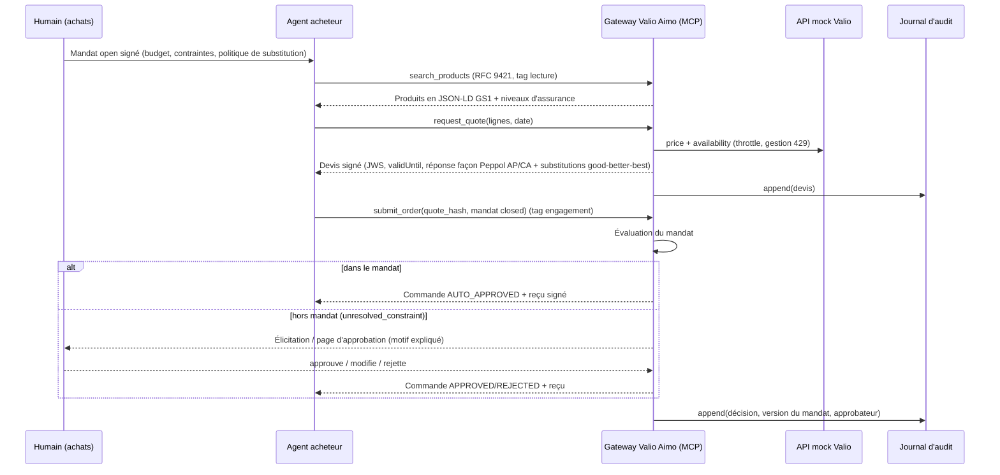

# Agentic commerce : comment l'industrie s'y prend, et quel avantage pour nous (challenge Valio Aimo)

*Recherche du 14/11/2026, menée par 7 sous-agents en parallèle. Une affirmation est dite « vérifiée » quand elle s'appuie sur 2 sources ou plus, ou sur la spécification officielle.*

## Synthèse

1. **Le paiement et la découverte de produits sont déjà couverts ; la confiance B2B ne l'est pas.** Les grands acteurs (Google AP2/UCP, OpenAI et Stripe avec ACP, Visa TAP, Mastercard Verifiable Intent, Coinbase x402) ont tous standardisé « qui paie et comment ». Aucun ne standardise ce que le vendeur affirme : stock, prix contractuel, origine, labels. Les flux produits B2C se limitent à un champ `availability` mis à jour une fois par jour. **Le challenge vise précisément ce manque.**
2. **Tous les acteurs arrivent au même schéma technique** :
   - (a) un mandat signé par l'humain, avec des contraintes typées ;
   - (b) un devis ou panier signé par le marchand, avec une date d'expiration ;
   - (c) une commande qui fait référence au hash de ce devis ;
   - (d) un reçu signé ;
   - (e) des requêtes HTTP signées (RFC 9421 / Web Bot Auth) pour identifier l'agent.

   On retrouve ce schéma chez AP2, Verifiable Intent, UCP, Visa TAP, x402, ACK v2 et KYAPay.
3. **Le B2B dispose déjà d'une grammaire de commande en Finlande : Peppol Ordering.** L'Order Response prévoit l'acceptation, l'acceptation avec modifications et le rejet, ligne par ligne, avec des quantités modifiées et un produit de substitution (`SellerSubstitutedLineItem`). L'État finlandais l'impose à ses fournisseurs depuis 2024. Le guide du commerce de détail finlandais **ne couvre pas la substitution** : c'est une case vide que nous pouvons occuper.
4. **Les leçons des plateformes** : les checkouts tout intégrés dans le chat ont échoué (OpenAI a réduit Instant Checkout en mars 2026, Walmart est revenu en arrière). Le modèle qui l'emporte : l'agent sert à la découverte, le vendeur garde la transaction et la relation client. Amazon s'est replié sur un jardin fermé. Le brief de Valio (« ne pas laisser une plateforme définir l'interface ») colle à cette tendance.
5. **Notre avantage** : une **interface ouverte hébergée chez le grossiste**, qui reprend les standards existants (MCP + AP2/VI pour le mandat + Peppol pour la commande + vocabulaire GS1 + RFC 9421). Elle y ajoute ce que personne ne fournit : un **niveau d'assurance pour chaque affirmation**, des **substitutions encadrées par une politique** et un **journal d'audit vérifiable**.

---

## 1. Carte des acteurs : comment ils s'organisent

### Paiements et mandats (fintech, réseaux de cartes)
| Acteur / protocole | Mécanisme clé | Ce qu'on reprend | Confiance |
|---|---|---|---|
| **Google AP2 v0.2** (28/04/2026) | Mandats SD-JWT VC « open » (contraintes) et « closed » (transaction précise). Mode *Direct* : l'humain signe. Mode *Autonomous* : l'agent signe le mandat closed avec la clé `cnf`. **Trusted Surface** obligatoirement non agentique pour le consentement. Reçu de mandat JWT signé `{iss,result,reference,error}`. Codes d'erreur : `unresolved_constraint`, `invalid_mandate`… | Toute la structure du mandat et des reçus. Contraintes `payment.budget`, `amount_range`, `execution_date`, `checkout.line_items`, `allowed_merchants`, contraintes personnalisées nommées en rDNS | vérifié (repo officiel) |
| **Mastercard Verifiable Intent** (v0.1, 03/2026) | Chaîne SD-JWT en 3 couches : L1 identité, L2 intention humaine, L3 exécution par l'agent. Vocabulaire de contraintes aligné sur AP2 | Confirme que ce vocabulaire de contraintes devient la norme de fait | vérifié |
| **OpenAI + Stripe ACP** (stable 2026-04-17) | REST `checkout_sessions` (état du panier qui fait foi + `messages`), `delegate_payment` avec un `Allowance{max_amount,currency,merchant_id,expires_at,checkout_session_id}`. Clé d'idempotence, versions par date | Ergonomie de l'API, `Allowance` comme « bon d'achat délégué » | vérifié |
| **Stripe Shared Payment Tokens** | Token `spt_` aux usages limités (montant, expiration), révocable, avec une machine à états | Machine à états du token délégué | vérifié |
| **Visa TAP** | Requêtes de l'agent signées en RFC 9421 avec le tag `agent-browser-auth` (navigation) ou `agent-payer-auth` (paiement), `expires` ≤ 8 min, `nonce`, registre d'agents | **Distinguer lecture et engagement dans la signature** | vérifié |
| **Mastercard Agent Pay** | Agents enregistrés et tokens agentiques, Web Bot Auth via Cloudflare | Enregistrement préalable de l'agent | vérifié |
| **Cadre KYA Visa/Mastercard/Ant** (09/2026) | Traçabilité de l'opérateur, certification, surveillance. Aucun format publié | Argument de discours seulement | plausible |

### Crypto et paiements de machine à machine
| Acteur | Mécanisme | Ce qu'on reprend | Confiance |
|---|---|---|---|
| **x402** (v2, Linux Foundation 04/2026, 40 membres dont Visa, Mastercard, Stripe, Adyen, AWS, Google, Shopify) | HTTP 402 + `PAYMENT-REQUIRED` (`accepts[]` : scheme, amount, payTo, maxTimeoutSeconds), puis `PAYMENT-SIGNATURE`, puis `/verify` (sans effet) et `/settle`, reçu dans `PAYMENT-RESPONSE`. Schemes extensibles | **Le motif « exigences lisibles par machine → autorisation signée → vérification → règlement → reçu »**, avec un scheme `invoice-net30` plutôt que de l'USDC | vérifié |
| **Nevermined** | Session keys ERC-4337, `spendingLimitCents` + `durationSecs`, vérifier puis exécuter puis régler, hash de transaction comme preuve d'audit | Délégation bornée en montant et en durée | vérifié |
| **Coinbase Agentic Wallets** | Plafond par session et par transaction, filtrage KYT, clés en TEE | Double plafond | vérifié |
| **Kraken MCP** | Groupes de services, profil par défaut **en lecture seule**, opérations dangereuses soumises à une **élicitation MCP** sauf `--allow-dangerous` | **Le motif exact du « dry-run par défaut »** | vérifié |
| **Binance Agent OS** | Sous-compte isolé, **aucun scope de retrait** | L'agent n'obtient jamais par défaut un droit irréversible | vérifié |
| **Skyfire KYAPay** (draft IETF) | JWT `kya`/`pay` : `hid` (humain), `apd` (plateforme), `aid` (agent), JWKS dans `.well-known` | Claims d'identité de l'agent | vérifié |
| **Catena ACK v2** | Abandonne les VC/DID au profit de JOSE + RFC 9421 (« trop lourd ») ; ACK-Pay devient un profil x402 | **Signal : rester sur JOSE + JWKS, pas sur DID/VC complets** | plausible |
| **Payman** | Plafond par transaction, limite journalière, liste blanche, **seuil d'approbation humaine** | Garde-fous types | plausible |

**Verdict sur x402 dans notre démo** : utiliser de l'USDC réel serait un gadget, car le foodservice B2B se règle sur facture à 30 jours. Mais **reprendre la grammaire 402 avec un scheme `invoice`** montre l'ouverture vers cet écosystème sans coût.

### Plateformes de commerce (B2C)
| Acteur | Ce qu'il fait | Leçon | Confiance |
|---|---|---|---|
| **UCP Google + Shopify** (01/2026, mise à jour 03/2026) | Profil `/.well-known/ucp`, **négociation de capacités** (intersection de ce que chaque partie supporte), extensions nommées en domaine inversé, états `incomplete → requires_escalation (+continue_url) → ready_for_complete`. Extension AP2 : JWS détaché sur un checkout canonisé en JCS | **`requires_escalation` = notre approbation humaine**. Découverte via `.well-known` | vérifié |
| **Shopify** Catalog/Cart/Checkout MCP | Niveaux de confiance par profil d'agent. robots.txt : « checkouts are for humans… final review step » | Niveaux de confiance accordés à l'agent | vérifié / plausible |
| **OpenAI** | Instant Checkout réduit en 03/2026. Le product feed se contente d'un champ `availability` (in_stock/out_of_stock/backorder/unknown) mis à jour chaque jour | **La donnée de confiance est le vrai manque** | vérifié |
| **Amazon** | Bloque environ 50 agents, Buy for Me chez les autres. Procès contre Perplexity : la cour d'appel du 9e circuit juge que l'agent est un « outil de l'utilisateur » (08/2026) | Risque de lock-in et de scraping : mieux vaut une API agent explicite | vérifié |
| **Walmart, Microsoft Copilot, Perplexity, Salesforce** | Hybrides : découverte dans l'assistant, transaction chez le vendeur | Le vendeur reste marchand de record | vérifié |
| **NLWeb / llms.txt / Arazzo** | `/ask` + MCP en Schema.org. llms.txt peu utilisé. Arazzo décrit des workflows d'API | Arazzo pour décrire le flux recherche → devis → approbation → commande | vérifié / plausible |

### Achats B2B et foodservice
| Acteur | Mécanisme | Leçon | Confiance |
|---|---|---|---|
| **Coupa Navi Connect** (MCP, R46 09/2026) | « Bring your own agent ». **L'agent ne peut pas sauter une étape d'approbation**. Plus de 450 clients | Les grandes suites d'achat ouvrent déjà MCP aux agents externes | vérifié / plausible |
| **Amazon Business** (10/2026) | Le système d'achat du client envoie ses politiques et budgets ; Amazon répond prix, dispo, délai ; la commande repasse par les workflows du client. **Prix bloqué 7 à 14 jours pendant l'approbation**, jusqu'à 6 niveaux, approbateurs de secours, l'approbateur peut modifier | **Devis bloqué + modèle d'approbation** | vérifié / plausible |
| **SAP Joule** | 3 niveaux d'autonomie : signale / résout et explique / corrige seul | **Niveaux d'autonomie** dans le mandat | vérifié |
| **Pepper** (e-commerce de distribution alimentaire) | Correspondances de substitution définies par le distributeur, drapeau ERP « No Substitute » par client, **substitution partielle (40 = 20 + 20)**, impossible de valider sans traiter l'alerte | **Politique de substitution déclarée** | plausible |
| **Sysco Swap and Save** | Substitutions recommandées (marque propre, moins cher) selon l'historique et la compatibilité | Classement « good-better-best » | vérifié |
| **Choco, US Foods MOXē** | IA qui transforme email, voix ou photo en commande structurée | Le marché foodservice a déjà numérisé la *saisie*, pas la *confiance* | vérifié |
| **Pactum (Walmart)** | Négociation autonome avec environ 2 000 fournisseurs, environ 3 % d'économie | Hors périmètre (le brief impose des prix fixes) | vérifié |
| **Seuils typiques** | < 500 $ auto / 500–2 500 manager / 2 500–10 000 directeur | Valeurs de démo, à présenter comme configurables | plausible |

---

## 2. Standards réutilisables (le « kit » d'interopérabilité)

| Couche | Standard retenu | Pourquoi | Maturité |
|---|---|---|---|
| Transport agent ↔ grossiste | **MCP spec 2026-07-28** : sans état, MRTR `input_required`, `outputSchema`/`structuredContent`, extension `tasks`, contexte OTel dans `_meta` | Adoption maximale ; les états `input_required` et `tasks` couvrent l'attente d'approbation | vérifié |
| Approbation humaine dans le protocole | **MCP elicitation** (`form` pour une confirmation, `url` pour la page d'approbation) ; option **CIBA + RAR** (`authorization_details` = la commande) pour une validation sur téléphone | Standard, et démontrable | vérifié |
| Permissions | OAuth 2.1 MCP : scopes `catalog:read` / `quote:create` / `order:submit`, **step-up** sur `403 insufficient_scope` | Pas de permissions inventées | vérifié |
| Agent ↔ agent (option) | **A2A v1.0** : Agent Card signée (JWS + JCS) dans `/.well-known/agent-card.json`, état `AUTH_REQUIRED` = approbation humaine | Façade de découverte | vérifié |
| Identité de l'agent (KYA) | **RFC 9421 / Web Bot Auth** (`Signature-Agent` + JWKS), tags lecture et engagement façon Visa TAP | Même mécanisme chez Visa, Mastercard, Cloudflare, ACK et KYAPay : **signal le plus convergent de toute la recherche** | vérifié |
| Mandat | **Mandat open/closed d'AP2 v0.2** (SD-JWT ou JWS), contraintes standard + `fi.valioaimo.*` | Vocabulaire commun AP2/VI/UCP | vérifié |
| Devis à prix ferme | Devis signé par le marchand (**JWS détaché sur JSON canonisé JCS**, façon UCP `merchant_authorization` / AP2 `checkout_jwt`), avec `validUntil` ; la commande référence `quote_hash` | Non-répudiation dans les deux sens | vérifié |
| Commande / réponse | **Peppol BIS Ordering 3 / UBL** : `OrderResponseCode` AB/AP/**CA**/RE, `LineStatusCode` 1/3/5/7, `SellerSubstitutedLineItem` ; GTIN avec `schemeID 0160` | Gère nativement la dispo partielle et la substitution ; imposé par l'État finlandais | vérifié |
| Données produit | **GS1 Web Vocabulary** (JSON-LD, extension de schema.org) : `PackagingMarkedLabelAccreditationCode`, `NutritionalClaimTypeCode`, `AllergenTypeCode`, soit **exactement les codes Synkka de notre dataset** | Aucun vocabulaire à inventer | vérifié |
| Affirmations de provenance et labels | **UN Transparency Protocol (UNTP)** : Digital Product Passport, Digital Conformity Credential (attestation par un tiers), Digital Traceability Event (dérivé d'EPCIS) ; ancrage sur **GS1 Digital Link** `id.gs1.org/01/{GTIN}` ; référence au **e-COI TRACES** pour le bio (cachet qualifié eIDAS) | Modèle le plus directement réutilisable pour « origine + labels » | vérifié |
| Audit | Journal append-only **chaîné par hash / arbre de Merkle**, façon Certificate Transparency / Sigstore Rekor v2 (checkpoint signé, preuve d'inclusion) | Aucun protocole d'agent n'impose de journal : **manque à combler** | vérifié (technique) |
| Gouvernance | Alignement volontaire sur l'**AI Act art. 14 §4 (d)(e)** (annuler, arrêter) et l'**art. 12** (journaux) ; échéances pour le haut risque repoussées au 02/12/2027 ; le mandat sert de **consentement contractuel** (PSD3/PSR silencieux sur les agents) | Argument de conformité anticipée | vérifié (dates) / incertain (qualification haut risque) |

**À citer comme feuille de route, sans les implémenter en 48 h** : European Business Wallet (règlement en cours d'adoption), DPP ESPR (l'alimentaire n'est pas inclus), Gaia-X/EDC/CEADS (trop lourd ; on garde l'idée des politiques ODRL), ANP/AGNTCY, DID/VC complets.

---

## 3. Notre avantage : ce qu'on peut faire que personne ne fait

### A. Un niveau d'assurance pour chaque affirmation (*le « trust protocol »*)
Aucun flux du marché ne dit *à quel point* une donnée est sûre. Chaque champ de nos offres porte une provenance :

| Affirmation | Niveau | Source dans nos données |
|---|---|---|
| Prix | `SELLER_SIGNED` (engageant jusqu'à `validUntil`) | API price |
| Stock | `VERIFIED_STOCK` (quantité réelle) / `UNKNOWN_SUPPLIER_STOCK` (Terminal, 999999) / `UNAVAILABLE` | API availability, `logisticModel` |
| Fiabilité de livraison | `OBSERVED_HISTORY` (0–1) | CSV de fiabilité |
| Label bio, MSC… | `SELF_DECLARED` (GS1 Synkka) → `THIRD_PARTY_ATTESTED` (DCC / référence TRACES), en option | `packagingMarkedLabel` |
| Origine | `MANUFACTURER_DECLARED` | `countryOfOrigin`, Synkka |
| Carbone | `CATEGORY_AVERAGE_ESTIMATE` | CSV carbone |

Le **mandat de l'acheteur** peut alors exiger, par exemple : « une ligne `UNKNOWN_SUPPLIER_STOCK` au-dessus de 500 € passe en revue humaine », « bio uniquement s'il est `THIRD_PARTY_ATTESTED` », « fiabilité ≥ 0,95 ». **C'est littéralement « faire confiance sans vérification manuelle »**, et cela s'appuie sur les vraies particularités du dataset (le 999999 confirmé par le développeur de Valio).

### B. Le mandat comme objet central, signé et versionné
Mandat open à la manière d'AP2, avec des extensions B2B absentes des standards B2C :
- `payment.amount_range`, `payment.budget` (par site et par période), `execution_date` ;
- `fi.valioaimo.autonomy_level` (échelle SAP : signale / propose / exécute) ;
- `fi.valioaimo.substitution_policy` (`none | same_brand | equivalent_spec | good_better_best` + écart de prix maximal) ;
- `fi.valioaimo.required_claims` (ex. `FREE_FROM_LACTOSE`), `required_labels`, `min_reliability`, `max_unverified_value` ;
- rôles B2B : *acheteur*, *approbateur*, *approbateur de secours* (ce que le B2C n'a pas).

Une contrainte non satisfaite déclenche `unresolved_constraint`, donc l'approbation humaine (`requires_escalation` en UCP, `AUTH_REQUIRED` en A2A, élicitation en MCP).

### C. Une Order Response Peppol qui gère enfin la substitution
On reprend AB/AP/CA/RE et les lignes 1/3/5/7. Cas du lait : **dispo partielle → CA + ligne 3 (quantité réduite) + ligne 1 / `SellerSubstitutedLineItem`** classées good / better / best (prix au litre, fiabilité, carbone, labels). Message pour le pitch : *« le guide Peppol du commerce finlandais exclut la substitution, nous la standardisons »*.

### D. Un audit vérifiable par les deux parties
Chaque événement (recherche, devis signé, évaluation du mandat, approbation, commande) est **signé et chaîné**. L'acheteur et Valio reçoivent un reçu avec preuve d'inclusion, et une vue lisible « ce que l'agent a fait et pourquoi » est générée à partir du même journal. Aucun protocole d'agent n'impose de journal aujourd'hui.

### E. Une interface ouverte, auto-hébergée et découvrable
`/.well-known/agent-card.json` signée + `server.json` (registre MCP) + profil de capacités façon UCP + fichier **Arazzo** du workflow + JSON-LD GS1. Le grossiste **héberge et contrôle** son interface, ce qui est l'inverse du modèle feed-vers-plateforme (Google Merchant Center, OpenAI). C'est exactement la phrase d'impact du brief.

---

## 4. Proposition de flux (synthèse des standards)

---

## Limites et angles morts

- **Valio Aimo** : aucune API agent, EDI ou Peppol publique trouvée ; seulement My Aimo / VALO Tilauspalvelu. À valider au stand : utilisent-ils Peppol Ordering ou de l'EDI avec leurs grands comptes ?
- **Labels en Verifiable Credentials** : aucun équivalent public trouvé pour MSC, Fairtrade ou Svanen. Le niveau `THIRD_PARTY_ATTESTED` sera **simulé** dans la démo.
- **Qualification AI Act** de notre agent comme système à haut risque : c'est notre inférence (probablement non), pas une source juridique.
- Chiffres peu solides : statistiques d'auto-approbation APQC/Hackett, chiffres Pactum (68 %, 87 s), 8 % de blocage de Buy for Me, adoption de llms.txt.
- Les « payment instructions » de Visa et le format des tokens Mastercard ne sont pas publics.
- La convergence vers JOSE plutôt que DID/VC (ACK v2) n'est confirmée que par une source ; AP2 et VI restent sur SD-JWT VC, compatible avec JOSE.

## Sources principales
- AP2 : https://github.com/google-agentic-commerce/AP2
- Verifiable Intent : https://github.com/agent-intent/verifiable-intent
- ACP : https://github.com/agentic-commerce-protocol/agentic-commerce-protocol
- Stripe SPT : https://docs.stripe.com/agentic-commerce/concepts/shared-payment-tokens
- Visa TAP : https://developer.visa.com/docs/trusted-agent-protocol/trusted-agent-protocol-specifications
- Cloudflare Web Bot Auth : https://blog.cloudflare.com/secure-agentic-commerce/
- x402 v2 : https://github.com/coinbase/x402/blob/main/specs/x402-specification-v2.md
- Nevermined : https://nevermined.ai/docs/products/x402-facilitator/how-it-works
- Kraken MCP : https://docs.kraken.com/home/mcp
- KYAPay : https://datatracker.ietf.org/doc/html/draft-skyfire-oauth-kyapay-token
- ACK v2 : https://catena.com/blog/ack-v2-smaller-identity-core-x402-payment-profile
- UCP : https://shopify.engineering/ucp ; https://ucp.dev/specification/payment/extensions/ap2-mandates/
- OpenAI commerce : https://developers.openai.com/commerce/guides/key-concepts
- Amazon c. Perplexity : https://www.retail-insight-network.com/newsletters/us-court-overturns-amazon-injunction-perplexity
- Coupa : https://www.coupa.com/newsroom/coupas-september-release-accelerates-agentic-spend-capabilities/
- Amazon Business : https://business.amazon.com/en/blog/end-to-end-procurement-launch ; https://business.amazon.com/en/blog/approvals-insights
- Pepper substitutions : https://help.usepepper.com/en/articles/13463070-item-substitutions
- Sysco : https://distributionstrategy.com/2026/04/sysco-expands-use-of-ai-tools-to-boost-sales-and-customer-growth/
- MCP 2026-07-28 : https://modelcontextprotocol.io/specification/2026-07-28/changelog
- A2A : https://a2a-protocol.org/latest/specification/
- CIBA+RAR : https://auth0.com/ai/docs/intro/asynchronous-authorization
- Peppol Order Response : https://docs.peppol.eu/poacc/upgrade-3/syntax/OrderResponse/tree/
- Guide Peppol Ordering pour le commerce finlandais : https://www.valtiokonttori.fi/en/maaraykset-ja-ohjeet/peppol-ordering-implementation-guide-for-finnish-retail-sector/
- GS1 Web Vocabulary : https://ref.gs1.org/voc/
- GS1 VC : https://ref.gs1.org/gs1/vc/data-model/1.0.1
- UNTP : https://uncefact.github.io/spec-untp/
- W3C VC 2.0 : https://www.w3.org/TR/2025/REC-vc-data-model-2.0-20250515/
- SD-JWT RFC 9901 : https://datatracker.ietf.org/doc/rfc9901/
- Sigstore Rekor v2 : https://blog.sigstore.dev/rekor-v2-ga/
- AI Act Omnibus : https://www.gibsondunn.com/eu-ai-act-omnibus-agreement-postponed-high-risk-deadlines-and-other-key-changes/
